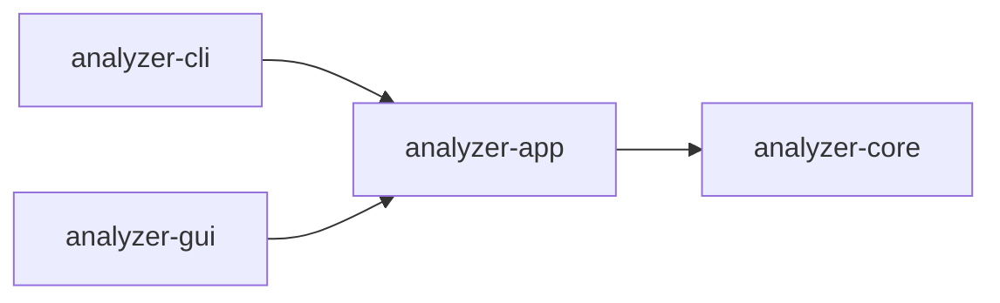

# Easy Analyzer

**Bring logs, process snapshots, and packet captures into one incident case. Investigate leads, check the original evidence, and preserve your analysis.**

Easy Analyzer is a cross-platform incident response analysis tool built with Rust, with both a command-line interface (CLI) and a desktop GUI. It supports Windows x64, Linux x64, and macOS ARM64 for offline evidence analysis, on-site investigation, and incident cases that continue across multiple days.

Parsing, rule checks, and IOC matching run locally by default. For AI assistance, you select the evidence scope and explicitly send it to your configured OpenAI-compatible service.

[Download](https://github.com/MoShouSecurity/Easy_Analyzer/releases) · [Quick start](#quick-start) · [Screenshots](#screenshots) · [Projects and IOCs](docs/PROJECTS.md) · [Changelog](CHANGELOG.md)

## Features

| Capability               | What it does                                                                                                                                                                                                                                                                         |
| ------------------------ | ------------------------------------------------------------------------------------------------------------------------------------------------------------------------------------------------------------------------------------------------------------------------------------ |
| Log analysis             | Import Windows EVTX, Linux login and SSH logs, Apache/Nginx access and error logs, and plain text. Supports custom web log formats, keyword searches, and regular expressions.                                                                                                       |
| Local rules              | Flag leads such as repeated failed logins, successful logins after failures, account and privilege changes, log clearing, service and scheduled task changes, suspicious script execution, and web attack requests.                                                                  |
| Process analysis         | Collect local processes or import JSON snapshots. Inspect process trees, paths, and command lines, and flag patterns such as encoded execution, download-and-run commands, execution from temporary directories, and Office launching script interpreters.                           |
| Offline traffic analysis | Import PCAP/PCAPNG files, inspect packets and bidirectional network sessions, and summarize packet counts, byte counts, and time ranges. Extract selected HTTP fields and DNS query names, with basic TLS protocol identification.                                                   |
| Case management          | Save each incident as a separate `.eair` project. Record client and response details, append evidence over time, and retain notes, AI history, IOC lists, and filters.                                                                                                               |
| IOC matching             | Import IPv4/IPv6 addresses, domains, and HTTP/HTTPS URLs from TXT/CSV, pasted text, or manual entry. Scan the current project offline, inspect matched values and field positions, and jump to the evidence.                                                                         |
| AI assistance            | Analyze all evidence, the current filter, or locally flagged suspicious items. Preview scope and budget before sending; split requests into batches and summarize across batches according to your configuration. Validate evidence references and retain valid results and history. |
| Response commands        | Browse, search, and copy 24 Windows commands and 24 Linux commands across six categories. Each includes execution environment, permissions, compatibility conditions, and parameter notes. No project is required, and the tool does not execute these commands.                     |
| Report export            | Export complete HTML/JSON reports with evidence sources, original records, and finding references. UI filters and pagination do not truncate the full evidence set in the report.                                                                                                    |

## Screenshots

These screenshots were captured on **October 13, 2026**, from the **native macOS ARM64 GUI, version 1.5.0**. The projects, logs, process snapshots, and packet captures use synthetic samples, with no real client cases or external AI requests. The interface labels shown in the screenshots are in Chinese.

**Case overview: evidence totals and findings to investigate**


<details>
<summary>Log details and IOC matches</summary>

**Log evidence · Dark mode: filter records and inspect the retained original text**


**IOC matching · Light mode: locate matched fields and evidence**


</details>

<details>
<summary>Windows / Linux response command library</summary>

**Windows commands · Light mode**


**Linux commands · Dark mode: network investigation category**


</details>

## Download and installation

Download the appropriate binaries from [GitHub Releases](https://github.com/MoShouSecurity/Easy_Analyzer/releases). Each release provides a CLI, a GUI, and `SHA256SUMS`. You can use the CLI and GUI independently.

| Platform    | CLI                                                   | GUI                                                                                                                                         |
| ----------- | ----------------------------------------------------- | ------------------------------------------------------------------------------------------------------------------------------------------- |
| Windows x64 | `easy-analyzer-cli-windows-x64.exe`                   | Stable releases provide `easy-analyzer-gui-windows-x64.exe`; previews provide `easy-analyzer-gui-windows-x64-setup.exe`. Requires WebView2. |
| Linux x64   | `easy-analyzer-cli-linux-x64`                         | `easy-analyzer-gui-linux-x64`. Requires GTK 3 / WebKitGTK 4.1.                                                                              |
| macOS ARM64 | `easy-analyzer-cli-macos-arm64`, requires macOS 11.0+ | `easy-analyzer-gui-macos-arm64.dmg`, requires macOS 13.0+. Open it and drag `Easy Analyzer.app` into Applications.                          |

Grant executable permission before running Linux binaries or the macOS CLI for the first time. For example, on Linux:

```sh
chmod +x easy-analyzer-cli-linux-x64 easy-analyzer-gui-linux-x64
```

The macOS GUI currently uses an ad-hoc signature and is not notarized. See the project documentation for the scope of build checks and testing on actual desktops; a successful build does not establish that every interaction has been verified.

## Quick start

### Desktop GUI

1. Create a project on the home page and enter the client organization and response start time. An incident can continue across multiple days; create a new project for a separate incident.
2. Select or drag in logs, process snapshots, and PCAP/PCAPNG files to start local analysis. On Windows/Linux, you can explicitly load common local logs or collect local processes.
3. Open “Analysis overview” to inspect findings. Filter records on the log, process, or network pages, then open details to verify the original content and source.
4. Add indicators in “IOC matching” and start a scan. Jump from a match to its evidence. Rescan as prompted after appending evidence or changing the IOC list.
5. For AI assistance, configure the service URL, model, and API key in settings. Select an evidence scope, review the sending preview, and start analysis.
6. Click “Save” to write the `.eair` file, and export HTML/JSON reports as needed. Open “Response commands” from the left sidebar at any time.

After opening a project, use “Edit details” in the toolbar or “Edit project details” on the home page to change its name, client organization, response start/end times, location, responders, and description. Click “Apply changes”, then “Save” to write the changes to the project file.

On “Log evidence”, the “multi-dimensional query” combines time ranges, levels, client IPs, HTTP status codes, methods, paths, loggers, hosts, and custom fields for Nginx/Apache, common Tomcat/Java application logs, and authentication logs. Windows-specific conditions expand separately. Ascending/descending chronological or original order applies before pagination. An explicit source UTC offset enables queries on full-date logs without a timezone, preserving original evidence. Query settings are saved with the project; see [log multi-dimensional query](docs/PROJECTS.md#log-multi-dimensional-query).

Projects, evidence, findings, diagnostics, IOCs, AI history, and references support pagination and direct page jumps. Large projects reuse selections and page bookmarks, with full details loaded on demand. See [pagination and large projects](docs/PROJECTS.md#pagination-and-large-projects).

**Projects are saved manually.** Move an `.eair` file to another machine to continue viewing imported evidence and analysis records, without the original input files or a separate database service. Removing a project from the catalog retains its project file, evidence, and IOCs.

### Command-line CLI

The examples use `easy-analyzer` as the executable name. You can rename the downloaded CLI or replace the name in the examples with its actual filename. In Windows PowerShell, run it as `./filename.exe`.

```sh
# Check logs with local rules
./easy-analyzer logs cases/Security.evtx -s

# Search with a keyword or regular expression
./easy-analyzer logs cases/auth.log -q "192.0.2.10"
./easy-analyzer logs cases/access.log -q 'union.*select|\.env' -r

# View the local process tree or import an existing snapshot
./easy-analyzer processes -t
./easy-analyzer processes cases/processes.json

# Analyze a packet capture offline and export a complete report
./easy-analyzer pcap cases/capture.pcapng -H reports/network.html

# Import multiple evidence types together
./easy-analyzer analyze cases/auth.log cases/processes.json cases/capture.pcapng

# List all commands and options
./easy-analyzer -h
```

**Create a project, append evidence, and continue a case:**

```sh
./easy-analyzer project create response.eair --client "Demo client"
./easy-analyzer project import response.eair cases/auth.log cases/capture.pcapng \
  --ioc indicators.csv --ioc-value example.com
./easy-analyzer project note response.eair --record EVIDENCE_ID --text "On-site investigation note"
./easy-analyzer project open response.eair -H reports/response.html
./easy-analyzer project list --search "Demo client"
```

The project name defaults to the client organization; use `--name` to override it. `project import` saves the appended data. `project open` does not reparse evidence or invoke AI automatically. Replace `EVIDENCE_ID` with an actual record ID. See [Projects and IOCs](docs/PROJECTS.md) for detailed save behavior and more examples.

**Enable AI assistance:**

```sh
./easy-analyzer config init
# Set base_url, model, and api_key in config.toml in the current directory
./easy-analyzer logs cases/Security.evtx -a -S suspicious
```

New configurations plan requests using the model context budget. Adjust the budget to the capabilities of your service and model. `config check` explicitly tests connectivity with a small request that contains no project evidence.

## IOC format

TXT files contain one IP address, domain, or complete URL per line. CSV uses `type,value` columns with an optional `note` column:

```csv
type,value,note
ip,192.0.2.10,Source to investigate
ip,2001:db8::1,Example IPv6 address
domain,example.com,Example domain
url,https://example.com/a?q=1,Example URL
```

Domain matching includes subdomains by default; use `--ioc-exact-domain` in the CLI for exact matches. URL matching ignores fragments while preserving path and query-string differences. Invalid entries are reported with their positions, and valid entries continue to import. IOC lists, notes, and matches belong only to the current project.

## Data handling and limitations

- AI sends selected evidence only when explicitly enabled and **does not automatically redact it**. For PCAP, parsed summaries are sent by default; raw packets and payloads require an additional selection. `.eair` files do not store AI keys.
- `.eair` is a self-contained project file managed with embedded SQLite and lossless evidence compression. The current project format is version 2 and cannot read version 1 files. Project files are not encrypted; handle them as case evidence.
- Network features are limited to offline capture analysis. Live capture, TCP reassembly, and TLS decryption are not supported. TLS support currently provides basic protocol identification only.
- IOCs currently support IP addresses, domains, and HTTP/HTTPS URLs. File hashes, CIDR ranges, wildcards, and online threat intelligence queries are not supported. Binary packet payloads are not scanned.
- Loading common local logs is available on Windows/Linux. On macOS, import offline logs. Collected evidence depends on permissions and log retention.
- Local rules, IOCs, and AI findings assist investigation and **do not confirm a compromise**. Assess them against original evidence, actual impact, and explanations based on normal behavior.
- The tool uses local files and manual saving. It does not provide multi-user collaboration, cloud synchronization, or autosave.

## Development and builds

The workspace contains a CLI, a GUI, a shared application layer, and an analysis core. Both frontends share parsing and analysis capabilities:



CLI/GUI handle interaction. The app layer handles analysis orchestration, projects, sessions, filters, background tasks, configuration, and export validation. The core handles parsing, rules, AI protocols, and report encoding.

Requires Rust 1.95+ and the build dependencies for your platform. The GUI also requires Node.js 22.12+. Linux GUI builds require development dependencies such as GTK 3 / WebKitGTK 4.1.

```sh
# CLI
cargo build --release --locked -p easy-analyzer

# GUI: build frontend assets first, then run the desktop application
npm --prefix crates/analyzer-gui/frontend ci
npm --prefix crates/analyzer-gui/frontend run build
cargo run --locked -p analyzer-gui

# Local checks
cargo fmt --all -- --check
cargo clippy --locked --workspace --all-targets -- -D warnings
cargo test --locked --workspace
npm --prefix crates/analyzer-gui/frontend test
npm --prefix crates/analyzer-gui/frontend run format:check
```

macOS packaging uses `tools/package-macos.sh` for the CLI and `scripts/package_gui_macos.sh` for the GUI. Windows installer packaging uses `scripts/package_gui_windows.py`. These scripts require Python 3.11+ and the corresponding platform toolchain, and write artifacts to `dist/`.

GitHub workflows handle platform builds, frontend checks, and packaging validation. Stable version tags publish stable Releases; `vX.Y.Z-preview.N` tags publish previews. Previews do not replace Latest, and ordinary source updates do not create Releases. Rust formatting, Clippy, and workspace tests run locally before pushing code changes.

## License

[MIT License](LICENSE) · Copyright © 2026 Easy Analyzer contributors